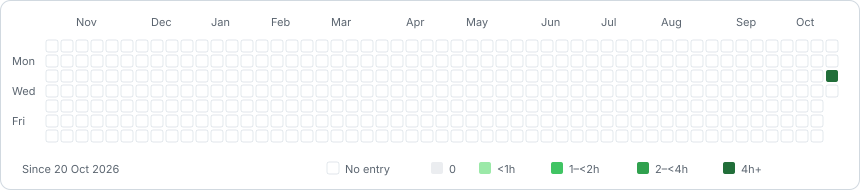

# Exploring Bitcoin

- [ ] [MIT lectures 1–6](mit-cryptocurrency-engineering-and-design/README.md)
- [ ] [Mastering Bitcoin](mastering-bitcoin/README.md)
- [ ] [Bitshala Programming Bitcoin](bitshala-programming-bitcoin/README.md)
- [ ] [Bitshala Bitcoin Protocol Development](bitshala-bitcoin-protocol-development/README.md)

<!-- learning-time:start -->
**Total learning time: 6 h 5 min**

<picture>
  <source media="(prefers-color-scheme: dark)" srcset="assets/learning-time-dark.svg">
  
</picture>
<!-- learning-time:end -->
