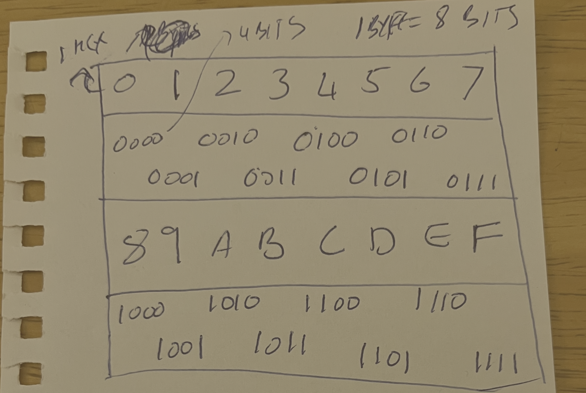
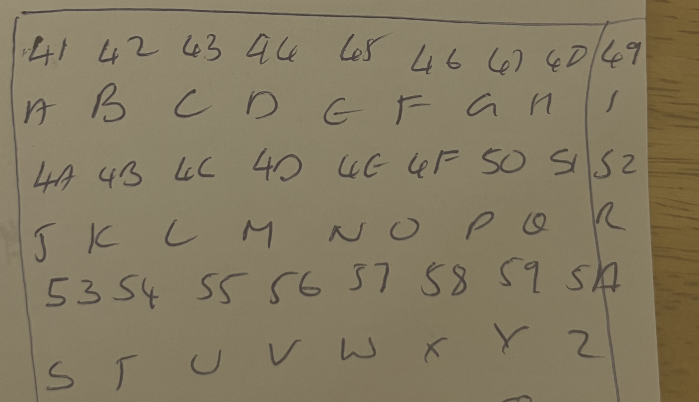
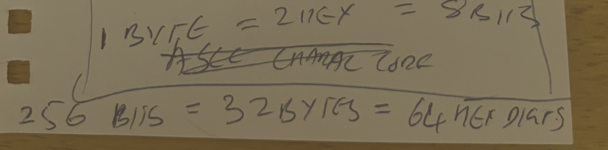
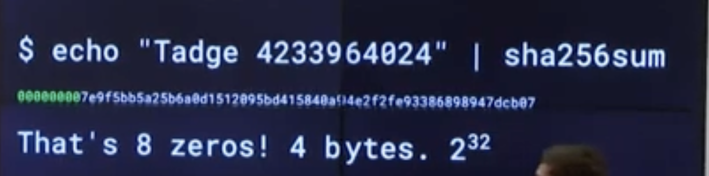
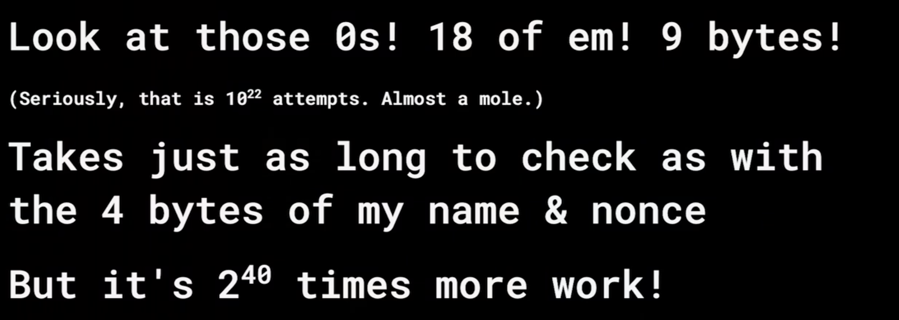

# Bits, bytes, hexadecimal and ASCII

[MIT notes and exercises](../README.md)

Handwritten notes by Arjun. Shared on 22 October 2026.

## Hexadecimal to binary



## ASCII character codes

The character codes are shown in hexadecimal.



## Bits, bytes and hexadecimal digits



## Eight leading zeros in a SHA-256 hash

Lecture screenshot shared by Arjun on 22 October 2026.



### Arjun's question and reasoning

Only clear typing, capitalization and punctuation errors have been corrected.

> How? 8 0's is 4 bytes?
>
> Isn't the echo result a hex output.
>
> Each hex is 1/2 byte.
>
> Does the pic mean... that each hex is 1/2 byte
> so the first 8 0's is 4 bytes?
>
> And how is that 2 32?
> Because that's 8 0's. 8 hex digits. Each hex is 4 bits... so 8 hex becomes 32 bits?
>
> Is this right?

### AI reply

Yes. Eight hexadecimal digits represent 32 bits, which is 4 bytes.
The final hash is displayed in hexadecimal by `sha256sum`.
The `echo` command supplies the text to hash.

```text
1 hex digit  = 4 bits
8 hex digits = 8 × 4 = 32 bits
32 bits      = 32 ÷ 8 = 4 bytes

Hex:      00         00         00         00
Binary:   00000000   00000000   00000000   00000000
          1 byte     1 byte     1 byte     1 byte
```

Each bit has two possible values: `0` or `1`.
So 32 bits have `2³²` possible patterns.
Only one of those patterns is all zeros.

If hash outputs behave like independent random values, the chance of the first
32 bits being zero is `1 in 2³²`.
The average number of attempts is `2³² = 4,294,967,296`.
An individual search can take fewer or more attempts.

The whole SHA-256 hash is 32 bytes.
The screenshot refers to its first 4 bytes being zero.

## Eighteen leading zeros and search effort

Lecture screenshot shared by Arjun on 22 October 2026.



### Arjun's explanation

Only clear typing and punctuation errors have been corrected.

> 18 leading 0's is 18 * 4 = 72 zero bits... so average attempts 2 to the power 72.
> 2⁷² -- is around 10²² attempts.
>
> Earlier... was 2³².
> So, this is more difficult by 2⁷² ÷ 2³² = 2⁽⁷²⁻³²⁾ = 2⁴⁰.
